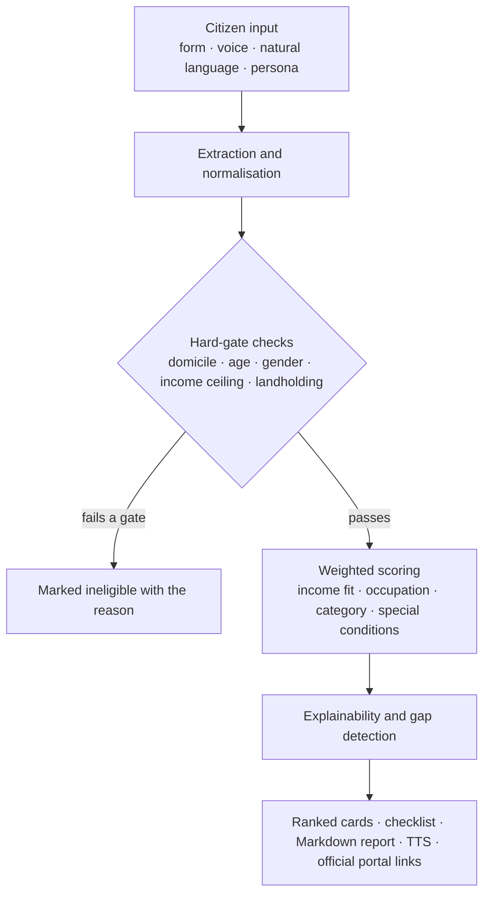

# SchemeMatch

**Explainable government scheme discovery and eligibility assistant for Karnataka and India.**

Built for **CodeHackers** — a hackathon project that turns fragmented welfare information into personalised, transparent, and actionable guidance.

[](https://react.dev/)
[](https://vite.dev/)
[](https://www.typescriptlang.org/)
[](https://expressjs.com/)
[](https://ai.google.dev/)
[](LICENSE)

---

## The Problem

Government welfare information is scattered across departmental portals, written in bureaucratic language, and gated behind eligibility rules that most citizens never see. People miss benefits they qualify for simply because they do not know a scheme exists or cannot tell whether they fit.

**SchemeMatch** replaces generic search with a rule-based engine that explains *why* a scheme matches, *what* is missing from a profile, and *where* to apply.

## What It Does

- **Weighted eligibility scoring** — every scheme is scored 0–100% and labelled *High*, *Moderate*, *Low*, or *Ineligible*, with the contributing factors shown.
- **Explainable recommendations** — plain-language reasoning ties a citizen's own attributes (student, woman head of household, small landholder) to scheme benefits.
- **Data-gap detection** — flags unverified income, caste/RD numbers, land records, and bank Aadhaar seeding before an application is rejected.
- **Three ways to enter a profile** — guided form, free-text or voice description, or a one-click demo persona.
- **Trilingual interface** — English, ಕನ್ನಡ, and हिन्दी across the whole app.
- **Voice in, voice out** — browser speech recognition for profile entry and text-to-speech for reading scheme summaries aloud.
- **Document readiness checklist** — Aadhaar, Nadakacheri RD certificates, Bhoomi RTC/FRUITS records, NPCI-seeded bank account.
- **Formal Markdown report** — a downloadable, copyable four-part report with the mandatory statutory disclaimer.
- **Grounded scheme copilot** — a conversational assistant limited to application steps, e-KYC, and official portals.

## Architecture



The knowledge base holds **22 schemes** (11 Karnataka state, 11 central) in a typed dataset; the matching engine is deterministic and runs entirely in-process, so results are reproducible and work without an API key.

<details>
<summary><strong>Request flow</strong></summary>

```
Browser ──► POST /api/extract-profile ──► Gemini (2.5 s timeout) ──► rule-based fallback
        └─► POST /api/copilot-chat   ──► Gemini ──► grounded offline reply
        └─► ranking, scoring, reports: all client-side, no network
```

</details>

## Tech Stack

| Layer | Technology |
| --- | --- |
| UI | React 19, TypeScript, Tailwind CSS v4, Lucide icons, Motion |
| Build | Vite 8 (`@vitejs/plugin-react`, `@tailwindcss/vite`) |
| Server | Express 4 on Node 20+, executed with `tsx` |
| AI | Google GenAI SDK (Gemini) with deterministic local fallback |
| Browser APIs | Web Speech API — `SpeechRecognition` and `SpeechSynthesis` |
| Tests | Node.js built-in test runner (`node:test`, `node:assert/strict`) |

## Project Structure

```
.
├── server.ts                     # Express API + Vite middleware / static production server
├── index.html                    # App shell and social meta tags
├── src
│   ├── App.tsx                   # Root layout, state, and screen composition
│   ├── components                # Header, profile builder, cards, drawers, chat, report modal
│   ├── data
│   │   ├── schemes.ts            # 22-scheme knowledge base with statutory rules
│   │   └── personas.ts           # Demo citizen profiles
│   ├── i18n/translations.ts      # English, Kannada, Hindi strings
│   ├── services/api.ts           # Server calls with client-side fallbacks
│   ├── types/scheme.ts           # Shared domain types
│   └── utils
│       ├── matchingEngine.ts     # Scoring, ranking, gap detection, report generation
│       ├── profileExtractor.ts   # Regex/keyword profile parser
│       └── speech.ts             # Speech recognition and synthesis wrappers
└── vite.config.ts
```

## Getting Started

### Prerequisites

- Node.js **20 or newer**, npm **10 or newer**
- Chrome or Edge recommended (full Web Speech recognition support)
- A Google Gemini API key — optional, see [Environment Variables](#environment-variables)

### Setup

```bash
git clone https://github.com/buzzy-coder-qween/SchemeMatch_CodeHackers.git
cd SchemeMatch_CodeHackers

npm install
cp .env.example .env      # then add your Gemini key
npm run dev               # http://localhost:3000
```

### Environment Variables

| Variable | Required | Purpose |
| --- | --- | --- |
| `GEMINI_API_KEY` | No | Enables AI profile extraction and the copilot. Without it the app uses the rule-based extractor and offline copilot answers. |
| `APP_URL` | No | Public URL of the deployment, used for self-referential links. Defaults to `http://localhost:3000`. |

`PORT` can be overridden with `--port` when starting the server; the default is `3000`.

### Scripts

| Command | Description |
| --- | --- |
| `npm run dev` | Start Express + Vite with HMR on port 3000 |
| `npm run build` | Build the client bundle into `dist/` |
| `npm start` | Run the server (`NODE_ENV=production` serves `dist/`) |
| `npm test` | Run the matching-engine, extractor, and speech test suites |
| `npm run lint` | TypeScript type check (`tsc --noEmit`) |
| `npm run clean` | Remove build output |

## Deployment

SchemeMatch is an Express app with `/api` routes, so it deploys as a **Node web service**, not a static site. A static host would serve the bundled UI but the AI extraction and copilot endpoints would 404 (the UI falls back to local parsing, so it stays usable, just without AI).

A [render.yaml](render.yaml) blueprint is included. On Render, choose **New → Web Service** and use:

| Setting | Value |
| --- | --- |
| Runtime | Node |
| Build command | `npm install && npm run build` |
| Start command | `npm start` |
| Health check path | `/api/health` |
| Env vars | `NODE_ENV=production`, `GEMINI_API_KEY=<your key>` |

The server reads the port from `PORT` (or `--port`), binds `0.0.0.0`, and with `NODE_ENV=production` serves the built assets from `dist/` with SPA fallback.

## API Reference

| Method | Endpoint | Description |
| --- | --- | --- |
| `GET` | `/api/health` | Liveness check, reports whether a Gemini key is configured |
| `GET` | `/api/schemes` | Full scheme knowledge base |
| `POST` | `/api/extract-profile` | Parse citizen text into a structured profile; returns `source: "gemini"` or `"rule-based"` |
| `POST` | `/api/copilot-chat` | Grounded scheme Q&A with optional active scheme context |

```bash
curl -X POST http://localhost:3000/api/extract-profile \
  -H "Content-Type: application/json" \
  -d '{"text":"I am a 21 year old female B.Sc student from Belagavi with family income 1.5 lakh"}'
```

## Scheme Coverage

| Karnataka | Central |
| --- | --- |
| Gruha Lakshmi · Yuva Nidhi · Shakti Scheme · Gruha Jyothi · Anna Bhagya · SSP Scholarship · Raitha Siri · Elevate Karnataka · Sandhya Suraksha · Arivu Education Loan · CMEGP | PM-KISAN · Ayushman Bharat (PM-JAY) · PM Mudra Yojana · PM Vishwakarma · Stand-Up India · PM Awas Yojana · Post-Matric SC/ST Scholarship · Atal Pension Yojana · Vidyasiri (FAAS) · AICTE Pragati · PM-USP CSSS |

Each entry carries its statutory rules, required documents, and the official portal link (Seva Sindhu, myScheme, SSP Karnataka, or the departmental site).

## Roadmap

- [ ] Persist profiles and applications in a database with citizen sign-in
- [ ] Expand coverage to all 28 states and union territories
- [ ] Add an admin workflow for scheme rule updates with source citations
- [ ] Notification reminders for document renewal and application deadlines

## Contributing

This is a hackathon project, but issues and pull requests are welcome. Run `npm run lint` and `npm test` before submitting, and keep the rule engine data-driven — scheme criteria belong in `src/data/schemes.ts`, not in component code.

## Team

**Team CodeHackers** — built for the CodeHackers hackathon.

## License

Released under the [MIT License](LICENSE).

---

> **Disclaimer:** This assistant provides likely matches and guidance based on your profile. It does not guarantee benefit approval. You must verify current eligibility conditions, required documents, deadlines, and application procedures with the relevant official government authority before applying.
